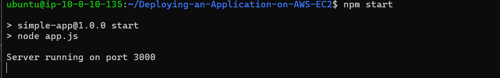
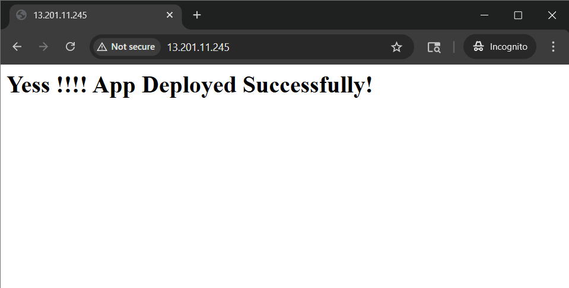

# 📦 Deploying a Node.js Application on AWS EC2 with NGINX

## 📌 Project Overview
This project demonstrates how to deploy a simple Node.js application on an AWS EC2 instance and use NGINX as a reverse proxy to serve the application on port 80.

## ⚙️ Tech Stack
- Node.js
- NGINX
- AWS EC2
- Ubuntu
- Git

## 🏗️ Architecture
Browser → EC2 Public IP (Port 80) → NGINX → Node.js App (Port 3000)

## 🚀 Features
- Simple Node.js HTTP server
- Reverse proxy setup using NGINX
- Deployed on AWS EC2
- Accessible via public IP

## 🧰 Prerequisites
- AWS account
- EC2 instance (Ubuntu)
- SSH access
- Node.js & npm installed

## 📥 Installation & Setup

### 1. Clone the Repository
```bash
git clone <your-repo-url>
cd <repo-folder>
```

### 2. Install Dependencies
```bash
npm install
```

### 3. Run the Application
```bash
npm start
```

App runs on:
http://localhost:3000

## 🌐 NGINX Configuration

Edit config:
```bash
sudo nano /etc/nginx/sites-available/default
```

### Configuration:
```nginx
server {
    listen 80;
    server_name _;

    location / {
        proxy_pass http://localhost:3000;

        proxy_set_header Host $host;
        proxy_set_header X-Real-IP $remote_addr;
        proxy_set_header X-Forwarded-For $proxy_add_x_forwarded_for;
    }
}
```

## 🔄 Restart NGINX
```bash
sudo nginx -t
sudo systemctl restart nginx
```

## 🔓 AWS Security Group Setup

Add inbound rule:
- Type: HTTP
- Port: 80
- Source: 0.0.0.0/0

## 🧪 Testing

### Test locally:
```bash
curl http://localhost:3000
```

### Test via NGINX:
```bash
curl http://localhost
```

### Access in browser:
http://<EC2-PUBLIC-IP>

## ⚠️ Common Issues

- Port already in use:
```bash
sudo kill -9 <pid>
```

- Stop all node processes:
```bash
sudo killall node
```

- Check NGINX status:
```bash
sudo systemctl status nginx
```

## 📸 Screenshots

### 1. Node.js Application Running


### 2. Application Running on Browser

